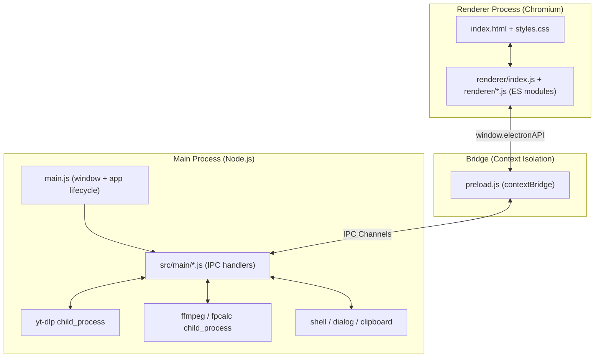

# YT-DLP GUI (YouTube Downloader)

A premium, open-source desktop application that wraps the powerful `yt-dlp` command-line utility in a beautifully designed Electron GUI. Built for content creators, video editors, and power users who need high-quality, reliable media downloads with a seamless user experience.

[](https://github.com/birol-dev/YT-DLP-GUI-/releases)

---

## Key Features

- 🎥 **High-Quality Video Downloads**: Download up to the **Max Quality** you pick into MP4 (H.264 video + AAC audio, the default, pre-optimized for Adobe Premiere/After Effects), MKV (best available video + audio in any codec), or WebM (VP9 + Opus).
- 🎵 **Variable Bitrate & Lossless Audio Extraction**: Extract audio streams directly to MP3 (LAME V0, the highest-quality VBR setting), M4A (AAC), FLAC (lossless compressed), or WAV (uncompressed 16-bit PCM at the source sample rate) via `ffmpeg`.
- 💬 **Subtitle Extraction**: Download uploaded and auto-generated YouTube captions for one language (or every language) without downloading the video itself.
- 📸 **Instagram Downloads**: Save Reels, posts, and IGTV videos as video, or extract their audio, in your preferred format.
- ✂️ **Video Clipper**: Preview a YouTube video in-app, set in/out points on an interactive timeline, and download only that section as video or audio.
- 🔪 **Video Divider Wizard**: Split local videos or imported YouTube videos with four modes (Fast keyframe copy, Precise frame-accurate re-encode, Equal length segments, and Spatial canvas cropping) and an interactive timeline scrubber.
- 🟣 **Twitch VOD Downloader**: Load any Twitch past broadcast, highlight or clip, pick a resolution from the real renditions (up to Source), set in/out points with a timeline, time fields or chapter chips, preview the stream in-app, and download just the selected part as MP4, MKV or audio.
- 🎞️ **Video to GIF Converter**: Trim a local video, choose output width and frame rate, and export a palette-optimized animated GIF with `ffmpeg`.
- 🎧 **Music Finder**: Identify songs inside a local audio/video file or a YouTube URL. The app samples the audio at a configurable interval and looks each slice up on **AcoustID** (free, fingerprinted locally with `fpcalc`) or **ACRCloud**.
- 🌐 **In-App Browser & Media Sniffer**: Browse sites inside the app; detected media streams (MP4, WebM, HLS `.m3u8`, DASH `.mpd`, audio) are listed in a sidebar where you can preview them or save them with `ffmpeg`.
- 🍪 **Cookie Passthrough**: Let yt-dlp use cookies from an installed browser (with optional profile), a Netscape `cookies.txt` file, or the in-app browser session, with a built-in cookie tester.
- 📦 **In-Page Download Complete Components**: Every download tab (**Video**, **Audio**, **Instagram**, **Subtitles**, **Video Clipper**, **Twitch VODs**, **Video Divider**, and **Video to GIF**) features a modern completion card with prominent **"Open Folder"**, **"Play / Open"**, **"Copy Path"**, and drag-and-drop thumbnail import actions.
- 📡 **Active In-Progress Download Card**: Displays real-time media metadata while downloading, including live YouTube video thumbnail, format & resolution badge (`VIDEO • 1080P MP4`, `AUDIO • MP3`), video title/filename, live transfer speed, ETA, and progress percentage.
- 📊 **Probed File Specifications Card**: Renders granular video details (file size, resolution, aspect ratio, frame rate, video codec, audio codec, and absolute file path) on the Video Divider and Video to GIF tabs, fully updated upon load and cleared upon reset.
- ⚙️ **Real-Time Settings Auto-Save**: All changes in Settings (base save locations, pre-selected video qualities, subtitle languages, container/codec formats, theme colors, notification sounds, and API keys) auto-save automatically in real-time.
- 🔄 **yt-dlp Hot-Swapping & Force Update**: Easily switch between **Stable**, **Nightly**, and **Master** builds with zero app restarts, or use the **Force Update yt-dlp** button to forcefully reinstall the latest release build anytime.
- ⚡ **Automatic Component Updates**: On launch (toggleable in Settings) the app updates yt-dlp with `--update-to <channel>` (no browser cookies involved) and falls back to a direct GitHub release download if that fails, for example because of a Windows file lock. FFmpeg is updated from ffbinaries builds and is never downgraded below a newer FFmpeg already on your system `PATH`.
- 🎨 **Dynamic Theme Accent Palettes**: Re-theme the entire application instantly with one of six curated accent palettes (Sleek Silver, YouTube Red, Cyan Spark, Emerald Green, Velvet Purple, and Amber Gold) driven by CSS variables.
- 🔊 **Dynamic Sound Synthesizer**: Premium double-tone completion chimes synthesized dynamically in real-time using the Web Audio API on successful downloads.
- 📂 **Auto-Reveal Downloads**: Optional setting to automatically open the download folder in your file manager and highlight the file once the download completes.
- 🎨 **Shadcn-Inspired Design**: A sleek, fully responsive true dark-mode dashboard featuring modern glassmorphism elements, Lucide UI icons, and smooth micro-animations.
- 🕒 **Cached Recents History**: Locally cached history (via `localStorage`) showing active YouTube thumbnails fetched dynamically from video IDs with double-click opening and drag-out import.

---

## Configuration & Media Formats

### 1. Supported Media Output Formats
The application allows you to configure preferred containers and codecs under the **Settings** tab. Dynamic card copywriting will update to explain compatibility based on your choice:

| Format | Type | Use Case & Details |
| :--- | :--- | :--- |
| **`MP4`** | Video | Optimized for maximum compatibility, specifically pre-configured with **H.264 / AAC** for instant import in Adobe Premiere Pro and After Effects. |
| **`MKV`** | Video | Matroska container holding the best available video and audio streams in any codec, ideal for high-quality archiving. |
| **`WebM`** | Video | High compression efficiency using VP9 video and Opus audio, ideal for web delivery. |
| **`MP3`** | Audio | Highly compatible audio extraction using LAME V0 (`--audio-quality 0`), the highest-quality Variable Bitrate (VBR) setting. |
| **`M4A`** | Audio | Highly efficient web-standard audio using the AAC codec. |
| **`WAV`** | Audio | Uncompressed 16-bit PCM at the source sample rate, ideal for sound editing. |
| **`FLAC`** | Audio | Lossless compressed format preserving high-fidelity audio while optimizing file size. |

### 2. Curated Theme Accent Colors
Transform the UI styling instantly with one of six custom-built accent color palettes:

- 🎚️ **Sleek Silver**: Minimalist steel gray, providing a clean professional interface.
- 🟥 **YouTube Red**: Brand-accurate vibrant red accents paired with deep dark mode.
- 💎 **Cyan Spark**: Energetic electric cyan styling for a futuristic tech look.
- 🟢 **Emerald Green**: Refreshing lively emerald palette with deep forest hues.
- 🔮 **Velvet Purple**: Premium royal velvet purple accents for a high-end luxury feel.
- 🪙 **Amber Gold**: Warm, rich metallic gold detailing for a premium touch.

### 3. Integrated Micro-Features
- **Status Terminal Resizer**: Drag the resize bar at the top of the Status Terminal to adjust its height manually between 100px and 450px.
- **Real-Time Progress Tracking**: Custom CSS transition-backed progress bar that reads stdout percentage from `yt-dlp` in real-time.
- **Concurrent Download Lockout**: Restricts the application from running multiple simultaneous download processes to prevent `yt-dlp` IP throttling and corruption of files.
- **Web Audio Chime**: An oscillator-synthesized success melody triggers automatically upon completion when enabled, using zero external audio files.

---

## Technical Architecture

The application strictly separates backend OS processes from the frontend rendering layer for security, utilizing Electron's safe IPC bridge architecture.



- **Main Process (`main.js` + `src/main/`)**: `main.js` creates the window, registers the privileged `media-preview://` and `browser-proxy://` schemes, and runs the startup dependency check. Each feature lives in its own module under `src/main/` (downloads, clipper, Twitch, divider, GIF, Music Finder scan, in-app browser, yt-dlp/FFmpeg management, settings, and so on). Modules register their IPC handlers when `main.js` requires them and share state through `src/main/ctx.js`. Pure helpers that tests load without Electron live in `src/main/clipper-streams.js` and `src/main/twitch-helpers.js`.
- **Preload Script (`preload.js`)**: A secure, isolated context bridge exposing only specific, safe IPC methods to the frontend as `window.electronAPI`, without exposing Node.js primitives.
- **Renderer Process (`renderer/`)**: `index.html` loads `renderer/index.js` as an ES module, which imports one module per tab or feature (`download.js`, `clipper.js`, `twitch.js`, `divider.js`, `gif.js`, `scan.js`, `browser.js`, `settings.js`, and so on) plus shared state in `renderer/state.js`. The root `renderer.js` is a leftover stub from before the module split and is not loaded.

---

## System Prerequisites

The application is fully self-contained and automatically configures its environment:

1. **`yt-dlp`**: Automatically downloaded and setup locally in the application's `userData/bin` directory on first launch if not already available in the system PATH. You can switch between **Stable**, **Nightly**, and **Master** release channels in Settings without restarting the app.
2. **`ffmpeg`**: Automatically downloaded (prebuilt ffbinaries release), extracted, and setup locally in `userData/bin` on first launch if not already available in the system PATH.
3. **`fpcalc`**: The Chromaprint fingerprinting tool used by Music Finder's AcoustID mode, downloaded and extracted into `userData/bin` the same way.

*Note: If you already have these tools installed in your system PATH, the application will detect them automatically and skip downloading. Switching or force-updating the yt-dlp channel always installs a local copy.*

*Optional:* if a Node.js runtime is found on your `PATH`, the app passes it to yt-dlp (`--js-runtimes node:<path>` with `--remote-components ejs:github`) so YouTube's JavaScript challenges can be solved and H.264 formats stay available.

### yt-dlp Release Channels

| Channel | When to use |
|---------|-------------|
| **Stable** | Default-safe choice for YouTube and general downloads |
| **Nightly** | Daily builds with the latest extractor patches |
| **Master** | Required for most Instagram downloads (includes browser impersonation via `curl_cffi`) |

Fresh installs default to **Master**; installs whose settings predate channel support stay on **Stable** until changed.

Open **Settings → yt-dlp Release Channel**, pick a channel, then click **Switch Channel Now** to hot-swap immediately or **Force Update yt-dlp** to reinstall the latest build. Both actions stop any running downloads, scans, or conversions first so the binary can be replaced. The status line displays the active installed version and whether it matches your selection.

---

## Getting Started

### 📦 Download Precompiled Binaries
You can download the latest precompiled standalone Windows installer (`.exe`) directly from the **[Releases Page](https://github.com/birol-dev/YT-DLP-GUI-/releases)**.

### 🛠️ Local Developer Setup

#### 1. Installation
Clone the repository and install the project dependencies (CI uses Node.js 22):

```bash
git clone https://github.com/birol-dev/YT-DLP-GUI-.git
cd YT-DLP-GUI-
npm install
```

#### 2. Development Mode
Launch the Electron window in development mode (`npm run dev` is an alias):

```bash
npm start
```

#### 3. Tests
Run the regression suite (Node's built-in `node:test` runner). It audits the source for IPC, DOM, and settings consistency, unit-tests the pure helpers, and runs a small performance benchmark:

```bash
npm test
```

#### 4. Packaging & Building

Compile and bundle the production-ready standalone Windows installer (`.exe`, NSIS) into `dist/` using **electron-builder**:

```bash
npm run dist
```

This encapsulates all code and maps designated icons (`build/icon.png`) into a single setup executable. `npm run pack` produces an unpacked directory build instead.

#### 5. Continuous Integration
`.github/workflows/build.yml` runs `npm test` and builds the installer on `windows-latest` for every push to `main` (uploaded as a workflow artifact). Pushing a `v*` tag, or a manual run with **publish** checked, publishes the installer to GitHub Releases.

---

## Automated Skills System

This repository includes a localized, project-specific skill directory under `.skills/` to guide developers and automation tools. 

- **Changelog & README Updater Skill** ([SKILL.md](.skills/changelog-updater/SKILL.md)): Instructs developers to automatically document all workspace changes, features, and refactoring under appropriate Semantic Version blocks in `CHANGELOG.md` and keep the master `README.md` updated as new features or configurations are added.

---

## License

This project is licensed under the MIT License. Feel free to use, modify, and distribute it for personal and commercial applications.
